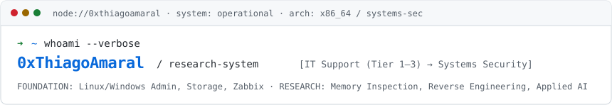

<picture>
  <source media="(prefers-color-scheme: dark)" srcset="assets/banner-dark.svg">
  <source media="(prefers-color-scheme: light)" srcset="assets/banner-light.svg">
  
</picture>

# Thiago Amaral

**IT Support & Infrastructure (Tier 1–3) → Systems Security & Applied AI Research** 
[GitHub](https://github.com/0xThiagoAmaral) · [LinkedIn](https://www.linkedin.com/in/thiago-infosec/)

[Overview](#overview) · [Background & Focus](#background-and-focus) · [Projects](#projects) · [Technologies](#technologies) · [Education & Background](#education-and-background)

---

## Overview

My professional background is in corporate IT support and infrastructure, progressing from technical intern to Tier-3 support and infrastructure analyst. That operational work involved administering production operating systems, network topologies, storage pools, enterprise backups, and troubleshooting incidents under SLA constraints.

Alongside that infrastructure foundation, I conduct independent technical research focused on **systems security**, **binary analysis**, and **applied AI** through hands-on codebases.

---

## Background and Focus

My technical focus bridges two complementary areas:

- **Systems & Binary Analysis**: Low-level Windows internals, process memory inspection, pattern scanning, and game runtime reverse engineering.
- **Infrastructure & Automation**: Linux/Windows server administration, enterprise backup and monitoring configurations, asset extraction pipelines, and agent environment tooling.

---

## Projects

### [Deadlock-Nightmare-Dumper](https://github.com/0xThiagoAmaral/Deadlock-Nightmare-Dumper)
*Stack: Python, Pymem, JSON*

A Python utility designed to scan target process memory in Valve's Deadlock (`deadlock.exe`). It uses `Pymem` to attach to the process and perform Array-of-Bytes (AoB) signature matching against `client.dll` and `engine2.dll` to find dynamic global offsets (`dwEntityList`, `dwLocalPlayerController`, `dwViewMatrix`, and `dwGlobalVars`).

The script serializes discovered global offsets along with predefined class offset structures and bone indices into `nightmare_offsets.json`. Static header definition files for C++ (`nightmare_offsets.hpp`) and C# (`nightmare_offsets.cs`) are committed in the repository.

*Scope note:* Runtime scanning accuracy and offset compatibility with recent game builds remain unverified. The Python script outputs JSON directly; writing `.hpp` and `.cs` from runtime data is not implemented in the script.

---

### [deadlock-open-assets](https://github.com/0xThiagoAmaral/deadlock-open-assets)
*Stack: Python, Batch, VPK parsing, GitHub Pages*

An asset extraction workflow and static catalog for Deadlock UI and gameplay resources. The repository contains a Python extraction script (`tools/extract_deadlock_assets.py`) that unpacks game VPK archives into organized assets (vector UI components, hero ability icons, and particle metadata) alongside structured JSON manifests (`manifests/heroes.json`, `items.json`).

Extracted resources are published through an open static catalog site hosted on GitHub Pages.

- **Catalog site:** [0xthiagoamaral.github.io/deadlock-open-assets](https://0xthiagoamaral.github.io/deadlock-open-assets/)

---

### [noc-lab](https://github.com/0xThiagoAmaral/noc-lab)
*Stack: Linux (Debian/CentOS), Windows Server, Bacula, Zabbix, Grafana, rsync*

A personal study laboratory and reference runbook repository documenting systems administration, network protocols, and infrastructure operations.

It provides modular Markdown reference guides and setup walkthroughs across 10 operational areas, including virtualized environments, network storage protocols (NFS, SMB, iSCSI), backup configurations using Bacula Community and rsync, and metric collection with Zabbix and Grafana.

---

## Technologies

Core technologies applied across these projects and in daily operational routines:

- **Systems & Memory Research:** Python (`Pymem`), process memory inspection, pattern scanning (AoB), PE structures.
- **Automation & Tooling:** Python CLI scripts, Bash, PowerShell, VPK archive extraction, JSON manifests and data serialization.
- **Infrastructure & Operations:** Linux (Debian, Ubuntu Server, CentOS), Windows Server, Bacula Community, Zabbix, Grafana, network storage (NFS, SMB, iSCSI), virtualization (Hyper-V, KVM).

---

## Education and Background

- **Education:**
  - **Postgraduate Specialization in Information Security** (*Pós-graduação Lato Sensu em Segurança da Informação*) — PUCPR (360h, 2024–2025).
  - **B.S. in Cyber Defense** (*Graduação em Defesa Cibernética*) — Estácio (2019–2021).
- **Practical Training & Labs:**
  - **SOC Level 1 Learning Path** — TryHackMe (87h 50m of defensive simulation: SIEM, traffic analysis, and incident triage).
- **Career Path:**
  - Progressive enterprise IT infrastructure experience, advancing from technical intern to Tier-1, Tier-2, and Tier-3 support and infrastructure analyst.
