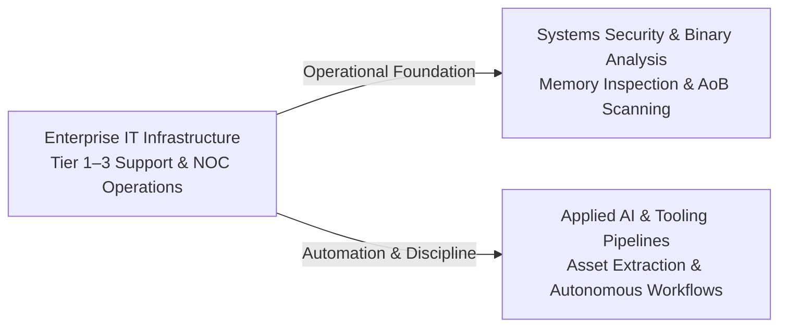

<picture>
  <source media="(prefers-color-scheme: dark)" srcset="assets/banner-dark.svg">
  <source media="(prefers-color-scheme: light)" srcset="assets/banner-light.svg">
  
</picture>

# Thiago Amaral

**IT Support & Infrastructure (Tier 1–3) → Systems Security & Applied AI Research** 
[GitHub](https://github.com/0xThiagoAmaral) · [LinkedIn](https://www.linkedin.com/in/thiago-infosec/)

[Overview](#overview) · [Background & Focus](#background-and-focus) · [Projects](#projects) · [Technologies](#technologies) · [Education & Background](#education-and-background)

---

## Overview

My professional background is in corporate IT support and infrastructure, progressing from technical intern to Tier-3 support and infrastructure analyst. That operational work involved administering production operating systems, network topologies, storage pools, enterprise backups, and troubleshooting incidents under SLA constraints.

Alongside that infrastructure foundation, I conduct independent technical research focused on **systems security**, **binary analysis**, and **applied AI** through hands-on codebases.

---

## Background and Focus

My technical focus bridges corporate operations with low-level systems engineering:

- **Systems & Binary Analysis**: Low-level Windows internals, process memory inspection, pattern scanning, and game runtime reverse engineering.
- **Infrastructure & Automation**: Linux/Windows server administration, enterprise backup and monitoring configurations, asset extraction pipelines, and agent environment tooling.

---

## Projects

| Project & Stack | Core Architecture & Focus | Status & Artifacts |
| :--- | :--- | :--- |
| [**Deadlock-Nightmare-Dumper**](https://github.com/0xThiagoAmaral/Deadlock-Nightmare-Dumper) `Python` · `Pymem` · `AoB Scanning` | Memory scanner targeting Valve's Deadlock (`deadlock.exe`). Inspects `client.dll` and `engine2.dll` to locate dynamic global offsets (`dwEntityList`, `dwViewMatrix`), serializing offsets to JSON alongside static C++/C# headers. | `Experimental` Runtime offset compatibility unverified against newest game builds. |
| [**deadlock-open-assets**](https://github.com/0xThiagoAmaral/deadlock-open-assets) `Python` · `VPK Parsing` · `GitHub Pages` | Automated asset extraction workflow unpacking game VPK archives into organized vector UI components, hero ability icons, and structured JSON manifests (`heroes.json`, `items.json`). | `Published Catalog` [Catalog Site ↗](https://0xthiagoamaral.github.io/deadlock-open-assets/) |
| [**noc-lab**](https://github.com/0xThiagoAmaral/noc-lab) `Linux` · `Bacula` · `Zabbix` | Practical laboratory runbook repository documenting systems administration, network protocols (NFS, SMB, iSCSI), backup configurations with Bacula Community, and telemetry with Zabbix and Grafana. | `Reference Runbook` Modular setup guides across 10 operational areas. |

---

## Technologies

Core technologies applied across these projects and in daily operational routines:

- **Systems & Memory Research:** Python (`Pymem`), process memory inspection, pattern scanning (AoB), PE structures.
- **Automation & Tooling:** Python CLI scripts, Bash, PowerShell, VPK archive extraction, JSON manifests and data serialization.
- **Infrastructure & Operations:** Linux (Debian, Ubuntu Server, CentOS), Windows Server, Bacula Community, Zabbix, Grafana, network storage (NFS, SMB, iSCSI), virtualization (Hyper-V, KVM).

---

## Education and Background

- **Education:**
  - **Postgraduate Specialization in Information Security** (*Pós-graduação Lato Sensu em Segurança da Informação*) — PUCPR (360h, 2024–2025).
  - **B.S. in Cyber Defense** (*Graduação em Defesa Cibernética*) — Estácio (2019–2021).
- **Practical Training & Labs:**
  - **SOC Level 1 Learning Path** — TryHackMe (87h 50m of defensive simulation: SIEM, traffic analysis, and incident triage).
- **Career Path:**
  - Progressive enterprise IT infrastructure experience, advancing from technical intern to Tier-1, Tier-2, and Tier-3 support and infrastructure analyst.
